<div align="center">


</div>

<table>
<tr>
<td width="40%" align="center">

</td>
<td width="60%" align="center">


<br>


</td>
</tr>
</table>

---

<div align="center">

</div>

<br>

## 🧪 Experiment Log

<table>
<tr>
<td colspan="2" valign="top">

### `run_001` · [Wind-Turbine](https://github.com/PranavMundhra/Wind-Turbine) &nbsp;🎓 college capstone
`PyTorch` `Federated learning` `Anomaly detection` `Paper in prep`

Can wind turbines learn what "healthy" looks like **without pooling their data**? I trained federated normal-behaviour autoencoders on the public CARE to Compare benchmark, with each of 22 turbines as its own client, and scored 58 real fault events.

```
status   : ✔ converged (5 seeds)
result   : FedAvg CARE 0.634 ± 0.007  vs  local 0.627 ± 0.004  → sharing models, not data, cost nothing
plot twist: found duplicated rows leaking between event files, built an audit to stop it
```

[**Interactive demo →**](https://pranavmundhra.github.io/Wind-Turbine/)

</td>
</tr>
<tr>
<td width="50%" valign="top">

### `run_002` · [RUL-Prediction-PVDAQ](https://github.com/PranavMundhra/RUL-Prediction-PVDAQ)
`Python` `Time-series` `Data quality`

Before predicting how long a solar panel has left, you have to trust the data. This pipeline grades every single day of NREL's PVDAQ System 50, catching duplicate sensors, snowstorms and outages, and **never averages its way out of a conflict**.

```
status : ⏳ warming up (data done, model next)
```

</td>
<td width="50%" valign="top">

### `run_003` · [Distributed-ML](https://github.com/PranavMundhra/Distributed-ML)
`FastAPI` `ONNX` `scikit-learn` `Distributed systems`

A distributed inference platform: one gateway, multiple CPU workers, round-robin routing, heartbeats to catch silent workers, and Lamport clocks so you can watch every request's path.

```
status : ✔ serving 3 models
```

</td>
</tr>
<tr>
<td width="50%" valign="top">

### `run_004` · [India in the Haze](https://github.com/kartiks15/ANRF_AISEHack_VibeCoders) &nbsp;👥
`PyTorch` `ConvLSTM` `Spatiotemporal` `ANRF AISE Hackathon`

Forecasting PM2.5 across all of India, 16 hours ahead, on a 140×124 grid. A ConvLSTM encoder-decoder with **physics-informed wind warping**, because pollution moves with the wind.

```
status : ✔ shipped at the hackathon
```

</td>
<td width="50%" valign="top">

### `run_005` · [VoiceRX](https://github.com/tech-aakash/AI-enabled-speech-based-clinical-notes-drafter) &nbsp;👥
`Whisper` `GPT-4o` `Neo4j` `SNOMED CT`

Doctor talks, notes write themselves. Speech goes through Whisper, symptoms get mapped to SNOMED CT codes in a Neo4j graph, and GPT-4o drafts a structured clinical note.

```
status : ✔ demo recorded
```

</td>
</tr>
<tr>
<td colspan="2" valign="top">

### `side_quest` · [OTtools](https://github.com/PranavMundhra/OTtools)
`Python` `Streamlit` `Optimization`

The stats-and-math corner: an app that solves linear programming and transportation problems, so operations research homework stops eating weekends.

</td>
</tr>
</table>

<sub>👥 = team project</sub>

<br>

## 🔬 Currently Training On

```diff
+ federated & privacy-preserving ML   (FedProx, FedPer, differential-privacy noise)
+ LLMs & agents                        (tool use, evals, making them actually useful)
- leetcode streaks                     (deprecated in favour of real projects)
```

<br>

## 🫘 The Grinder

<div align="center">


</div>

<br>

## 📊 Brew Metrics

<div align="center">


<picture>
  <source media="(prefers-color-scheme: dark)" srcset="https://raw.githubusercontent.com/PranavMundhra/PranavMundhra/output/snake-coffee-dark.svg" />
  
</picture>

</div>

<br>

## 🤝 Let's Grab a Coffee

<div align="center">

<a href="https://www.linkedin.com/in/pranavmundhra/"></a>
<a href="mailto:pranavmundhra2005@gmail.com"></a>
<a href="https://www.kaggle.com/pranavmundhra"></a>
<a href="https://instagram.com/pranavmundhra2005"></a>

</div>

<br>

<div align="center">

> *All models are wrong, but some are useful.*
> *All coffee is useful.*


**thanks for stopping by — the pot's always on and the GPU's always warm ☕**

</div>
